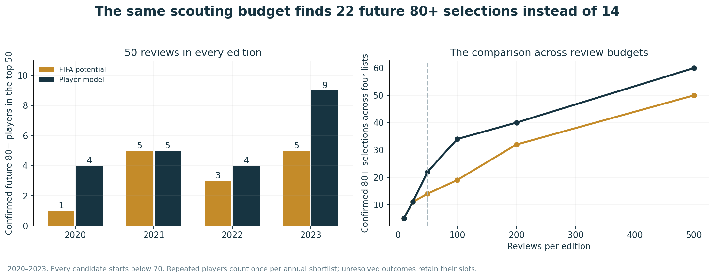
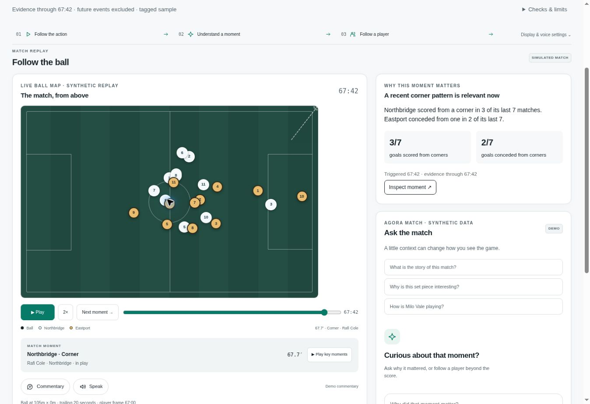
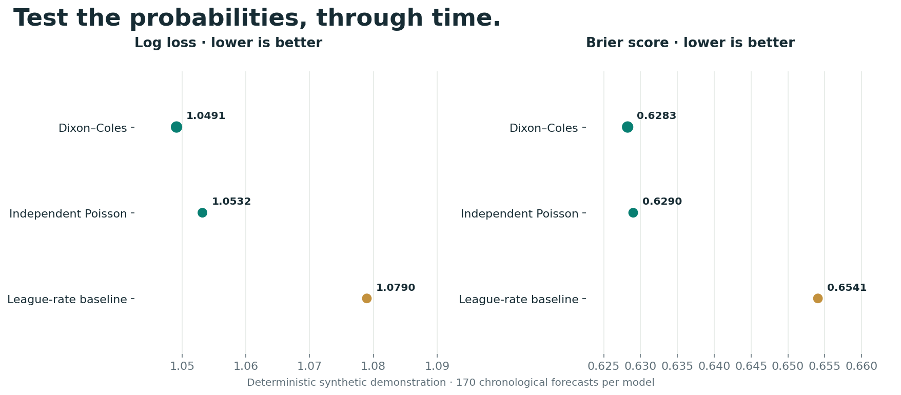

```{=html}
<section class="portfolio-hero">
  <div class="hero-main">
    <p class="eyebrow"><span class="status-dot"></span> SENIOR DATA SCIENTIST · GREECE</p>
    <h1>From a good question<br>to a <em>working system.</em></h1>
    <p class="hero-copy">I build predictive models, investigate uncertainty and turn evidence into decisions. These projects share the reasoning, results and engineering behind the work.</p>
    <div class="hero-actions"><a class="btn-primary-custom" href="projects/">Explore my work <span>→</span></a><a class="text-link" href="about.html">About me →</a></div>
  </div>
  <aside class="hero-aside" aria-label="Areas of work">
    <span class="aside-label">THE QUESTIONS I WORK ON</span>
    <div><b>01</b><p>What happens next?<small>Prediction & probabilistic modelling</small></p></div>
    <div><b>02</b><p>Does it make a difference?<small>Experimentation & decision quality</small></p></div>
    <div><b>03</b><p>Can someone use it?<small>ML systems & evidence-based AI</small></p></div>
    <a href="writing/" class="text-link">Read the analyses →</a>
  </aside>
</section>
<div class="section-intro"><p class="eyebrow">SELECTED WORK</p><h2>Three projects.<br>Different kinds of evidence.</h2><p>Historical research, an AI application and a probabilistic forecasting lab. Each makes its evaluation boundaries explicit.</p></div>
<article class="featured-study">
  <a class="featured-image" href="studies/fifa-hidden-gems/" aria-label="Read Beyond FIFA Potential"></a>
  <div class="featured-copy"><span class="project-kind">01 / PREDICTIVE MODELLING</span><h2><a href="studies/fifa-hidden-gems/">Beyond FIFA potential</a></h2><p>Can we find more future 80+ players while they are still rated below 70?</p><div class="result-line"><strong>22 <span>vs</span> 14</strong><small>confirmed successful selections<br>from the same 200 reviews</small></div><p class="fine-print">Four historical scouting replays. The model includes FIFA potential alongside player, team and peer features.</p><a class="text-link" href="studies/fifa-hidden-gems/">Read the analysis →</a></div>
</article>
<div class="secondary-studies">
  <article><a href="studies/agora-match/" class="study-image"></a><div class="secondary-copy"><span class="project-kind">02 / AI APPLICATION</span><h2><a href="studies/agora-match/">Agora Match</a></h2><p>One football match, three perspectives. An inspectable evidence layer for fans, analysts and coaches.</p><span class="evidence-label">Synthetic-data prototype</span><a class="text-link" href="studies/agora-match/">Explore the case study →</a></div></article>
  <article><a href="studies/football-forecasting/" class="study-image"></a><div class="secondary-copy"><span class="project-kind">03 / PROBABILISTIC MODELLING</span><h2><a href="studies/football-forecasting/">Football Forecasting Lab</a></h2><p>From score probabilities to season outcomes, with chronological backtests and proper scoring rules.</p><span class="evidence-label">Engineering MVP · synthetic benchmark</span><a class="text-link" href="studies/football-forecasting/">Inside the forecasting lab →</a></div></article>
</div>
<section class="practice-section"><p class="eyebrow">HOW I WORK</p><h2>A result needs a baseline.<br>A model needs a use.</h2><div class="practice-grid"><div><h3>Start with the decision</h3><p>Define the outcome, the available information and the action the analysis should support.</p></div><div><h3>Make the test credible</h3><p>Respect time, compare relevant baselines and show uncertainty and failure cases.</p></div><div><h3>Leave a usable artifact</h3><p>Connect the explanation to reproducible code, a notebook or an application people can inspect.</p></div></div></section>
<section class="contact-strip"><div><p class="eyebrow">CONTINUE THE CONVERSATION</p><h2>Code, notebooks and the ideas behind them.</h2></div><div><a class="text-link" href="https://github.com/rafaelnikitas">GitHub →</a><a class="text-link" href="https://www.kaggle.com/rafanikitas">Kaggle →</a></div></section>
```
