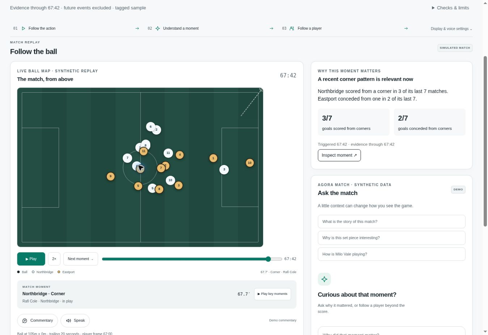
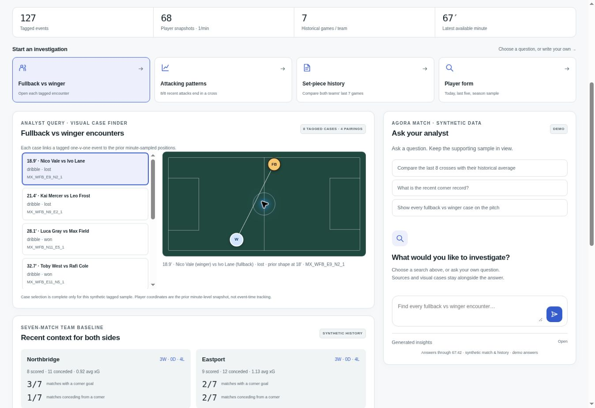

::: {.study-links}
[View repository](https://github.com/rafaelnikitas/agora-match){.btn .btn-outline-primary} [Try the static demo](https://agoramatch.russettitan64.chatgpt.site/){.btn .btn-outline-primary} [Watch the demo](https://youtu.be/nxC-Q8esbOQ){.btn .btn-outline-primary}
:::

## The question

A fan, an analyst and a coach can watch the same football match and need very different explanations. I built Agora Match to let them inspect the same evidence through those different perspectives.

The project uses **fictional synthetic clubs, players, events and telemetry**. It is an application prototype, not an evaluated scouting or coaching service.

## An explanation tied to the match clock

The central design decision is a shared replay cutoff. Chat, statistics, ratings, heatmaps and context should all describe the match as it was known at the selected moment. Rewinding removes future events from the available evidence.

That makes an explanation inspectable. A reader can return to the event, check the source facts and see the sample size behind the claim.

| Perspective | What the interface supports |
|---|---|
| Fan | Replay, player profiles, recaps and explanations of notable moments |
| Analyst | Tagged matchup cases, historical comparisons and evidence exports |
| Coach | Qualified review cues, player details and an evidence-based discussion |

## Where AI belongs

Application code retrieves the evidence and computes the statistics. The optional Microsoft Foundry workflow turns that bounded evidence bundle into audience-appropriate explanations through analyst, narrator and reviewer roles. References and canonical fact values are checked by application code.

The static demonstration uses deterministic fallback answers. The separate Azure application and its recorded Foundry verification are documented in the repository. Those checks do not establish that a multi-role workflow is qualitatively better than a single model.

## Evaluation and failure behaviour

The repository records checks for temporal cutoffs, evidence references, role routing and mocked model failures. Its documented release suite includes 67 unit/API tests, 82 synthetic acceptance examples and 73 browser-fallback checks. These are software and contract checks, not a live LLM accuracy score.

The next evaluation is qualitative: compare generated explanations against human judgments of correctness, usefulness and unsupported claims. Latency, fallback rate and evidence coverage need to sit alongside that assessment.

## What the prototype demonstrates

- A complete path from a synthetic event contract to an inspectable user interface.
- A clear boundary between calculated facts and model-written explanations.
- Replay-aware retrieval, qualified wording and usable fallback behaviour.
- Deployment and verification instructions alongside the application code.

Sparse position samples do not establish fatigue or a missed tactical assignment. The interface describes them as qualified cues, and all demonstration data remains explicitly synthetic.

## Reproduce and inspect

The [repository README](https://github.com/rafaelnikitas/agora-match#run-it-locally) includes a no-key static build, a Python API, a container and optional Azure setup. The [evaluation notes](https://github.com/rafaelnikitas/agora-match/blob/main/docs/accuracy-and-evaluation.md) document the scope of each check.
