::: {.study-links}
[View code](https://github.com/rafaelnikitas/fifa-hidden-gems){.btn .btn-outline-primary} [Open Kaggle notebook](https://www.kaggle.com/code/rafanikitas/football-s-hidden-gems-ml-vs-fifa-potential){.btn .btn-outline-primary} [Explore the scouting replay](../../demos/scouting.html){.btn .btn-outline-primary}
:::

::: {.callout-note}
The model uses FIFA potential as an input. This study compares that combined model with potential ranking alone. Results are retrospective; the latest prospective shortlist is dated 21 September 2025.
:::


I compared a player model with FIFA potential to find future 80+ players while they were still rated below 70.

## 1. A shortlist before the breakthrough

FIFA potential is a natural place to start a scouting shortlist. I wanted to test whether the same review budget could find more future quality when I added a player's skills, development and surroundings.

I ranked players with **overall below 70, at any age**, and checked whether they reached **80+ in the next three editions**. Previously observed 85+ players were excluded. I compared 50 selections per edition across 2020–2023.

**The ML model uses FIFA potential and potential headroom as predictors.** I compare this combination with ranking by potential alone. The extra information comes from player skills, development history, club strength and relative standing among peers.

## 2. The prediction timeline

I trained each model using only outcomes available at its decision date. For a 2023 shortlist, training profiles end in 2020, with their three-edition outcomes known by 2023. The shortlist is then evaluated using 2024–2026 ratings.

A recorded 80+ rating confirms a positive outcome. A negative requires all three future records. Players with incomplete follow-up stay unresolved: disappearing from the dataset does not count as stagnation.

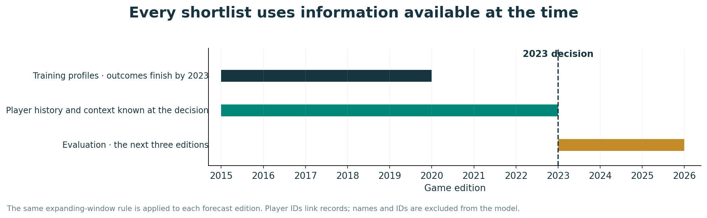

## 3. More discoveries from the same budget

**The player model finds 22 confirmed future 80+ selections; FIFA potential finds 14.** That is eight additional hits from the same 200 review slots, or 57% more confirmed hits.

The model matches or exceeds potential in each annual top-50 list: 4 versus 1, 5 versus 5, 4 versus 3, and 9 versus 5. The budget curve shows how the comparison changes as the shortlist grows.

Some players recur across editions. Confirmed precision uses all review slots; confirmed recall uses the 101 documented positive player-edition outcomes. Unresolved players remain in both rankings.

```{=html}
<div class="computed-evidence"><table class="dataframe future-table">
  <thead>
    <tr style="text-align: right;">
      <th>Ranking</th>
      <th>Confirmed 80+</th>
      <th>Distinct players</th>
      <th>Reviews</th>
      <th>Confirmed precision</th>
      <th>Confirmed recall</th>
    </tr>
  </thead>
  <tbody>
    <tr>
      <td>Player model</td>
      <td>22</td>
      <td>20</td>
      <td>200</td>
      <td>11.0%</td>
      <td>21.8%</td>
    </tr>
    <tr>
      <td>FIFA potential</td>
      <td>14</td>
      <td>12</td>
      <td>200</td>
      <td>7.0%</td>
      <td>13.9%</td>
    </tr>
  </tbody>
</table></div>
```

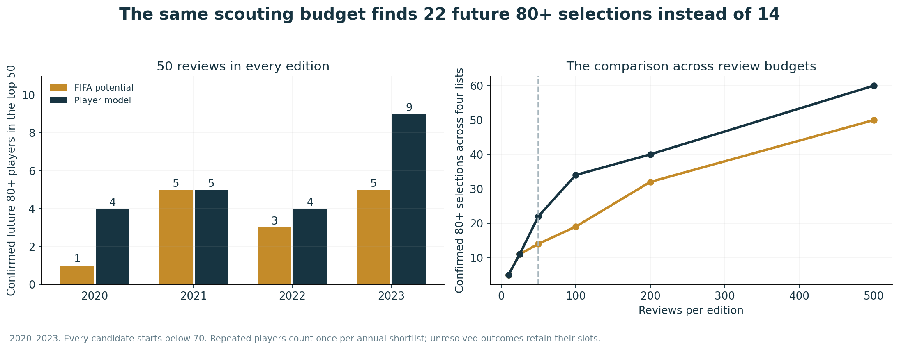

```{=html}
<div class="computed-evidence"><details><summary>Annual precision, recall and outcome counts</summary><div class="future-audit"><table class="dataframe future-table">
  <thead>
    <tr style="text-align: right;">
      <th>Edition</th>
      <th>Eligible players</th>
      <th>Confirmed 80+</th>
      <th>ML found / 50</th>
      <th>ML precision</th>
      <th>ML recall</th>
      <th>ML unresolved</th>
      <th>FIFA found / 50</th>
      <th>FIFA precision</th>
      <th>FIFA recall</th>
      <th>FIFA unresolved</th>
    </tr>
  </thead>
  <tbody>
    <tr>
      <td>2020</td>
      <td>12813</td>
      <td>17</td>
      <td>4</td>
      <td>8.0%</td>
      <td>23.5%</td>
      <td>8</td>
      <td>1</td>
      <td>2.0%</td>
      <td>5.9%</td>
      <td>5</td>
    </tr>
    <tr>
      <td>2021</td>
      <td>13519</td>
      <td>28</td>
      <td>5</td>
      <td>10.0%</td>
      <td>17.9%</td>
      <td>9</td>
      <td>5</td>
      <td>10.0%</td>
      <td>17.9%</td>
      <td>9</td>
    </tr>
    <tr>
      <td>2022</td>
      <td>13774</td>
      <td>27</td>
      <td>4</td>
      <td>8.0%</td>
      <td>14.8%</td>
      <td>2</td>
      <td>3</td>
      <td>6.0%</td>
      <td>11.1%</td>
      <td>9</td>
    </tr>
    <tr>
      <td>2023</td>
      <td>13334</td>
      <td>29</td>
      <td>9</td>
      <td>18.0%</td>
      <td>31.0%</td>
      <td>6</td>
      <td>5</td>
      <td>10.0%</td>
      <td>17.2%</td>
      <td>8</td>
    </tr>
  </tbody>
</table></div></details></div>
```

## 4. Uncertainty around the gain

I resampled whole player IDs across all four editions and rebuilt the top-50 lists in each draw. This preserves the connection between repeated observations of the same player.

The pooled difference is **+8 confirmed hits**, with a conditional 95% interval of **+1 to +15**. Individual seasons have wider intervals. This calculation holds the fitted models and historical cohorts fixed; it does not include model-selection uncertainty or variation across future seasons.

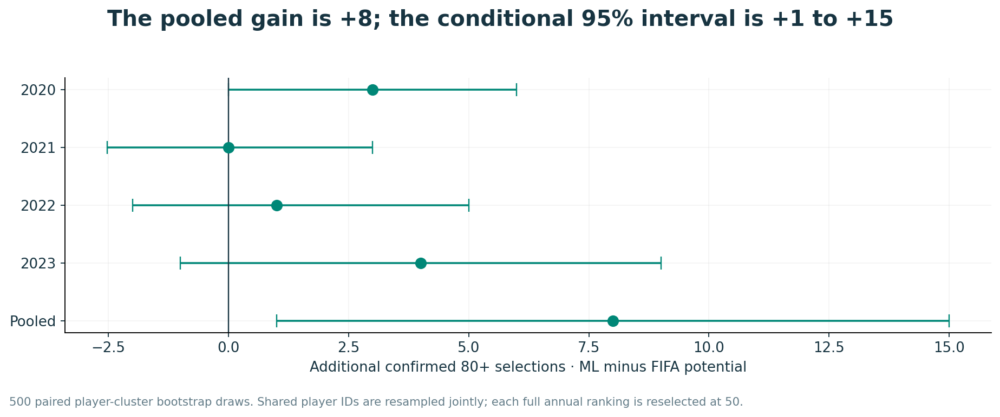

## 5. The information behind the improvement

I retrained the same model after removing two groups of information. The target, training dates, weights and CatBoost settings stayed fixed.

Without **team and peer context**, confirmed hits fall from 22 to **11**. Without **player history**, they fall to **17**. A model using only age, current rating, potential, headroom and position finds **7**.

The conditional interval for the context difference is **+3 to +19** hits. The history difference is less precise: **-1 to +11**.

The largest drop comes from removing context: club strength, standing within the squad, and comparisons with players of the same position and age. The removal losses overlap because the remaining features are retrained together.

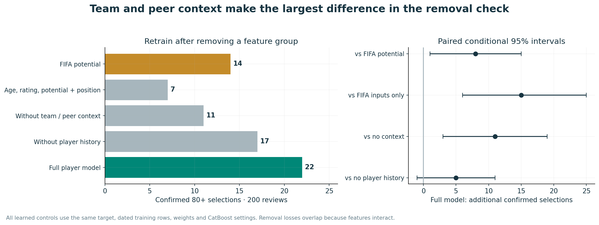

## 6. The signals learned by the model

**Potential remains the strongest individual feature.** The added information changes how that potential is interpreted. Among the leading inputs are club top-11 strength, listed squad status, rating rank for the same age and position, and position-specific skill rank.

The chart shows how each feature contributes to the fitted ranking. Points to the right raise a player's score; colour shows whether the feature value is relatively low or high. Importance is measured on a random sample of 1,200 eligible 2023 players, rather than only successful discoveries.

Club strength and peer standing help distinguish players with similar overall ratings. These are predictive associations: a contribution from club strength does not establish that joining a stronger club causes development.

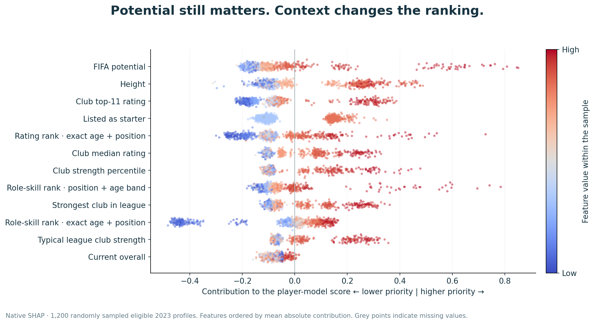

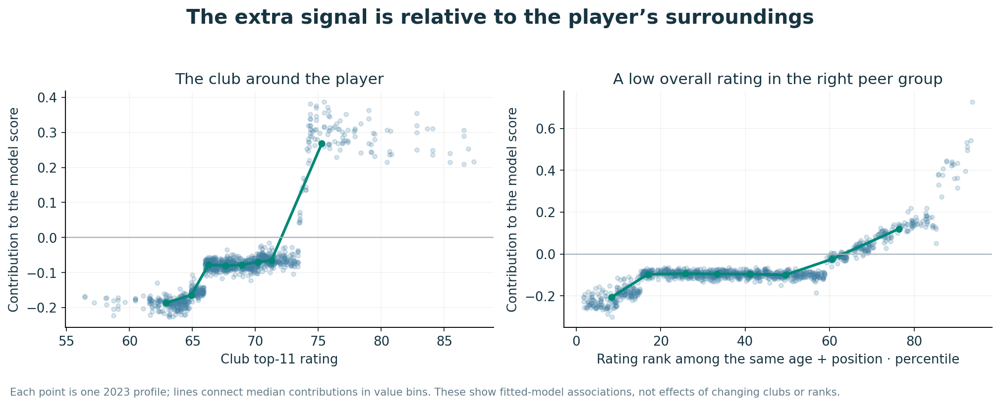

## 7. The players each approach finds

The difference between the lists is visible at player level. **Eleven confirmed breakouts appear only in the ML top 50; three appear only in FIFA's.** Another eleven appear in both. The net gain is eight selections.

The rank plot includes all 101 confirmed player-edition breakouts. Players near the top right were prioritised by ML and ranked much lower by FIFA potential. Players near the bottom left show the reverse.

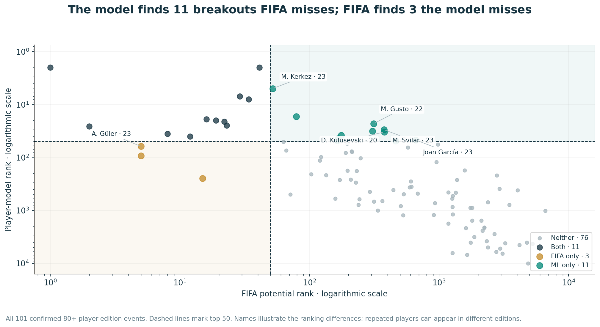

## 8. Similar profiles, different futures

I also compared players by the shape of their attributes. The coordinates were fitted on 2015 outfield profiles and then held fixed. The two displayed dimensions retain **34.1%** of profile variation.

Similar profiles can still have different outcomes. The map combines similarity with the two shortlists and the later rating reveal. Nearest-player comparisons use all 28 normalised skill dimensions within the same position group; goalkeeper comparisons use five goalkeeping attributes.

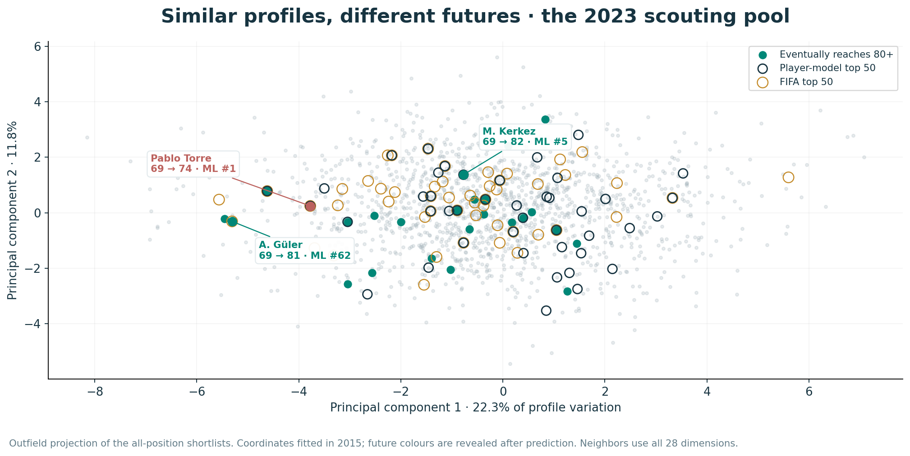

## 9. An interactive scouting replay

The scouting replay lets me compare rankings within an edition, position or nationality. Filters rerank the full eligible pool. Clicking a player reveals the recorded career and an available individual explanation.

[Open the interactive scouting replay](../../demos/scouting.html){.btn .btn-outline-primary}

The replay opens in its own page so the full player pool and interactive charts load only when requested.

## 10. Discoveries, false alarms and misses

In 2023, **M. Kerkez** and **M. Svilar** both started at 69 and later reached 82. The model ranked them fifth and thirtieth; FIFA potential ranked them fifty-second and 376th.

The same model ranked **Pablo Torre** first, but his observed peak in the window was 74. It also placed **A. Güler** sixty-second and missed him at top 50. These examples include discoveries, a false alarm and a miss.

Individual SHAP values connect these rankings to specific inputs. They sum, with the expected score, to the fitted raw score. The displayed bars are the six largest contributions; the score is a ranking index rather than a calibrated probability.

```{=html}
<div class="computed-evidence"><table class="dataframe future-table">
  <thead>
    <tr style="text-align: right;">
      <th>Player</th>
      <th>Overall</th>
      <th>Potential</th>
      <th>ML rank</th>
      <th>FIFA rank</th>
      <th>Peak in window</th>
      <th>Outcome</th>
    </tr>
  </thead>
  <tbody>
    <tr>
      <td>M. Kerkez</td>
      <td>69</td>
      <td>83</td>
      <td>5</td>
      <td>52</td>
      <td>82</td>
      <td>Confirmed 80+</td>
    </tr>
    <tr>
      <td>M. Svilar</td>
      <td>69</td>
      <td>79</td>
      <td>30</td>
      <td>376</td>
      <td>82</td>
      <td>Confirmed 80+</td>
    </tr>
    <tr>
      <td>Pablo Torre</td>
      <td>69</td>
      <td>86</td>
      <td>1</td>
      <td>6</td>
      <td>74</td>
      <td>False alarm</td>
    </tr>
    <tr>
      <td>A. Güler</td>
      <td>69</td>
      <td>86</td>
      <td>62</td>
      <td>5</td>
      <td>81</td>
      <td>Missed 80+</td>
    </tr>
  </tbody>
</table></div>
```

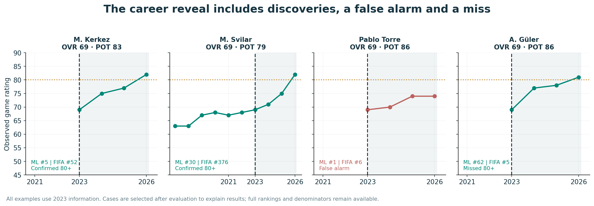

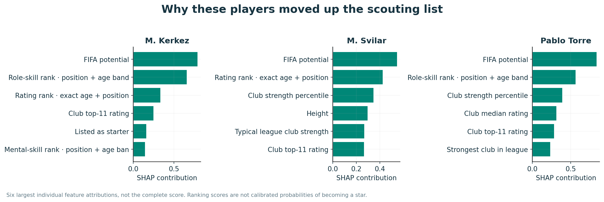

## 11. How I selected the final model

I treated this as a ranking problem: given the same 50-player review budget, which approach finds more confirmed future 80+ players? I compared FIFA potential, compact learned controls, the player model, and extensions with current or forecast role profiles.

The 431-input player model had the strongest top-50 result in the four historical replays. I kept its CatBoost settings fixed for the feature-removal comparisons: 450 iterations, depth 5, learning rate 0.045, L2 regularisation 12, border count 64 and seed 42. Shallower trees and regularisation limit the complexity of each fitted interaction.

**I did not run an automated hyperparameter search or use these evaluation cohorts for early stopping.** This is an exploratory model/feature comparison on an archive studied previously; its replay periods are not an untouched final test set.

**I did not calibrate the output probabilities.** Sample weights emphasise the scouting use case, so I use the raw model output only to order players. A high ranking is not a stated percentage chance of reaching 80+. If I wanted probabilities, I would fit a calibration step on a separate mature validation window and check reliability and a proper probability score.

```{=html}
<div class="computed-evidence"><table class="dataframe future-table">
  <thead>
    <tr style="text-align: right;">
      <th>Candidate</th>
      <th>Inputs</th>
      <th>Confirmed 80+ selections</th>
    </tr>
  </thead>
  <tbody>
    <tr>
      <td>FIFA potential</td>
      <td>Potential ranking</td>
      <td>14</td>
    </tr>
    <tr>
      <td>FIFA inputs only · CatBoost</td>
      <td>11 · age / rating / potential / role</td>
      <td>7</td>
    </tr>
    <tr>
      <td>Player model</td>
      <td>431</td>
      <td>22</td>
    </tr>
    <tr>
      <td>Player + current role</td>
      <td>435</td>
      <td>14</td>
    </tr>
    <tr>
      <td>Player + linear trend</td>
      <td>443</td>
      <td>13</td>
    </tr>
    <tr>
      <td>Player + learned future</td>
      <td>443</td>
      <td>17</td>
    </tr>
  </tbody>
</table><table class="dataframe future-table">
  <thead>
    <tr style="text-align: right;">
      <th>Step</th>
      <th>What I used</th>
    </tr>
  </thead>
  <tbody>
    <tr>
      <td>Validation</td>
      <td>Four chronological expanding-window replays; every training outcome ends by the decision edition.</td>
    </tr>
    <tr>
      <td>Selection criterion</td>
      <td>Confirmed 80+ selections at top 50, with precision, recall, unique players, misses and conditional intervals alongside it.</td>
    </tr>
    <tr>
      <td>Hyperparameters</td>
      <td>One fixed CatBoost configuration for the player-feature comparisons. No automated hyperparameter search or early-stopping selection on the evaluation cohorts.</td>
    </tr>
    <tr>
      <td>Fixed settings</td>
      <td>450 iterations; depth 5; learning rate 0.045; L2 12; border count 64; seed 42.</td>
    </tr>
    <tr>
      <td>Training weights</td>
      <td>Sub-70 emphasis, balancing repeated player histories and bounded extra weight for rare large improvements.</td>
    </tr>
    <tr>
      <td>Calibration</td>
      <td>Not performed. The outputs are raw ranking scores, rather than calibrated probabilities.</td>
    </tr>
    <tr>
      <td>Latest-snapshot refit</td>
      <td>The selected specification is fitted to all eligible mature labels available by the forecast edition. The bundled FC26 model uses 66,811 training profiles from origins 2015–2023.</td>
    </tr>
  </tbody>
</table></div>
```

## 12. What I found

**At a fixed review budget, adding player information improves the historical 80+ shortlist.** The gain is 22 versus 14 confirmed selections. Team and peer context produce the largest loss when removed.

The stricter pool of players never previously rated 70+ gives **23 versus 14** confirmed selections. For the rarer 85+ outcome, the model and potential each find **5**; there are only ten documented 85+ player-edition events in these cohorts.

I also tested forecast role-profile features. That extension finds 17 future 80+ selections at top 50, below the player model's 22. The improvement over potential comes from the player model; the role forecast did not improve this shortlist.

The scouting value is a better order for reviewing low-rated players. The next evaluation is a frozen pipeline on later-maturing cohorts, with match performance and playing time alongside game ratings.

```{=html}
<div class="computed-evidence"><details><summary>Data and methods</summary>
    <p>Men's annual FIFA15–FC26 snapshots. Exact player IDs link editions. Historical snapshots use the first available update; FC26 is the September 2025 snapshot. FC25 supplies future ratings but lacks potential.</p>
    <p>The player model has 431 inputs: current skills, age and physique, potential, past development, and contemporaneous team/peer context. Context uses edition-specific club and league IDs where available. Peer groups use exact age and primary position, or two-year age bands and a broader role. Percentiles are shrunk toward 0.5 for small groups. Names, player IDs, nationality and future outcomes are excluded from the predictors.</p><table class="dataframe future-table">
  <thead>
    <tr style="text-align: right;">
      <th>Feature group</th>
      <th>Inputs</th>
    </tr>
  </thead>
  <tbody>
    <tr>
      <td>Age / physique</td>
      <td>5</td>
    </tr>
    <tr>
      <td>Current skills</td>
      <td>64</td>
    </tr>
    <tr>
      <td>FIFA potential</td>
      <td>2</td>
    </tr>
    <tr>
      <td>Player history</td>
      <td>91</td>
    </tr>
    <tr>
      <td>Team / peer context</td>
      <td>269</td>
    </tr>
  </tbody>
</table>
    <p>CatBoost: 450 iterations, depth 5, learning rate 0.045, L2 12, border count 64, seed 42. Training includes sub-80 origins with no previously observed 85+ rating; labels must finish by the forecast edition. Sub-70 origins receive extra weight, repeated player histories are balanced, and rare large positive jumps receive bounded extra weight. All feature-removal models use the same settings and weights. Past club and peer changes remain in the context block; player history contains the player's own rating/skill changes, trends and observed career coverage.</p>
    <p>FIFA potential ranks descending; ties use higher current overall, younger age, then player ID. ML ties use player ID. Potential describes a longer horizon than the three-edition target; the comparison is at the same review budget.</p>
    <p>Precision is confirmed positives divided by all selections. The corresponding upper bound treats unresolved selections as positive. Recall uses documented positive outcomes. Source dropout can leave outcomes unknown. This is a retrospective replay on a previously explored archive, rather than untouched prospective validation. Bootstrap intervals condition on the fitted models and the four historical cohorts.</p>
    <p>The similarity transform, scaling and PCA are fitted in 2015. The outfield map excludes goalkeepers; scouting rankings include them. The interactive FC26 watchlist is based on the September 2025 source snapshot and has no mature three-edition outcomes.</p>
    <p>Sources: <a href="https://www.kaggle.com/datasets/stefanoleone992/ea-sports-fc-24-complete-player-dataset">Stefano Leone · FIFA15–FC24 · CC0</a>; <a href="https://www.kaggle.com/datasets/nyagami/ea-sports-fc-25-database-ratings-and-stats">Davis Nyagami · FC25 · Apache 2.0</a>; <a href="https://www.kaggle.com/datasets/rovnez/fc-26-fifa-26-player-data">rovnez · FC26 · CC BY 4.0</a>. Earlier research on skill evolution: <a href="https://dtai.cs.kuleuven.be/events/MLSA19/papers/verstraete_MLSA19.pdf">Verstraete et al., 2019</a>. Individual explanations use <a href="https://catboost.ai/docs/en/concepts/shap-values">native CatBoost SHAP</a>.</p>
    </details></div>
```

## 13. The latest data-backed shortlist

I apply the selected player model to players still rated below 70, at any age, excluding previously observed 85+ players. The table shows the model's first 20 selections, their FIFA potential rank in the same eligible pool, and the inputs that most strongly support or oppose each model score.

FIFA potential is part of the ML model. Its value is interpreted together with the player's attributes, history, team and peers. The individual explanations separate the contribution of current potential and headroom from the contribution of all other inputs.

These are **unconfirmed prospective selections**. The data date and target editions are shown with the results. The bundled complete snapshot is dated **21 September 2025**; it is not a live November 2026 roster. The newer files checked below lack usable potential, so I do not replace it with invented or silently carried-forward values.

Each explanation uses native SHAP values from the selected model. Positive values raise the ranking score and negative values lower it. They describe the model's reasoning, rather than causes of future development.

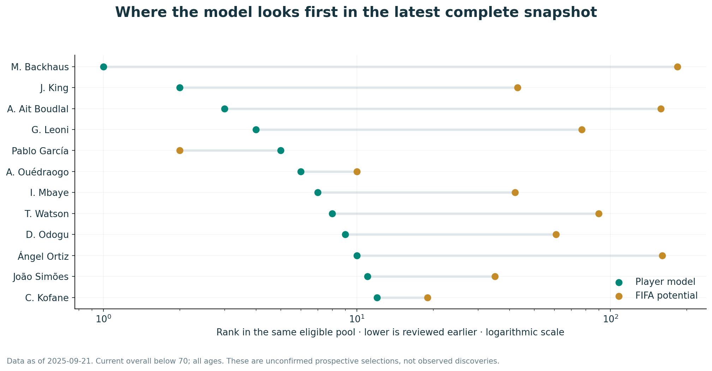

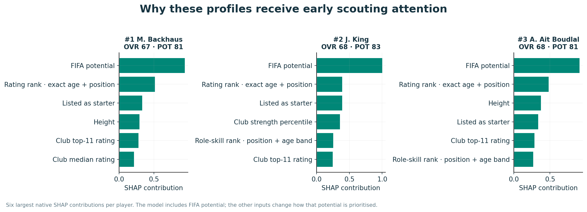

```{=html}
<div class="computed-evidence"><div class="future-finding"><b>Dated snapshot · not a live current-season shortlist</b><br>Data as of 2025-09-21 · FC26 · 13,154 eligible players · model: Player model.<br>Target: 80+ in editions 2027–2029; all listed outcomes remain unconfirmed.</div><div style="overflow:auto"><table class="future-table latest-list"><thead><tr><th>ML rank</th><th>Player / club</th><th>Age / role</th><th>OVR / POT</th><th>FIFA rank</th><th>Main supporting signals · SHAP</th><th>Main opposing signal · SHAP</th></tr></thead><tbody><tr><td>1</td><td><b>M. Backhaus</b><br><small>SV Werder Bremen</small></td><td>21 · GK</td><td>67 / 81</td><td>184</td><td>FIFA potential: 81 (+0.95); Rating rank · exact age + position: 89.1 percentile (+0.52)</td><td>Rating rank within position: 64.1 percentile (-0.08)</td></tr><tr><td>2</td><td><b>J. King</b><br><small>Fulham FC</small></td><td>18 · MF</td><td>68 / 83</td><td>43</td><td>FIFA potential: 83 (+1.00); Rating rank · exact age + position: 89.5 percentile (+0.39)</td><td>Position age pct dribbling: 93.8 percentile (-0.16)</td></tr><tr><td>3</td><td><b>A. Ait Boudlal</b><br><small>Stade Rennais FC</small></td><td>19 · CB</td><td>68 / 81</td><td>158</td><td>FIFA potential: 81 (+0.91); Rating rank · exact age + position: 92.0 percentile (+0.48)</td><td>Rating rank within position: 61.7 percentile (-0.06)</td></tr><tr><td>4</td><td><b>G. Leoni</b><br><small>Liverpool</small></td><td>18 · CB</td><td>69 / 82</td><td>77</td><td>FIFA potential: 82 (+0.82); Club strength percentile: 99.9 percentile (+0.46)</td><td>Listed as starter: no (-0.13)</td></tr><tr><td>5</td><td><b>Pablo García</b><br><small>Real Betis Balompié</small></td><td>18 · Wing</td><td>68 / 87</td><td>2</td><td>FIFA potential: 87 (+1.01); Club strength percentile: 95.6 percentile (+0.39)</td><td>Height: 175 cm (-0.13)</td></tr><tr><td>6</td><td><b>A. Ouédraogo</b><br><small>RB Leipzig</small></td><td>19 · MF</td><td>69 / 85</td><td>10</td><td>FIFA potential: 85 (+1.01); Height: 191 cm (+0.40)</td><td>Listed as starter: no (-0.14)</td></tr><tr><td>7</td><td><b>I. Mbaye</b><br><small>Paris Saint-Germain</small></td><td>17 · Wing</td><td>68 / 83</td><td>42</td><td>FIFA potential: 83 (+0.95); Role-skill rank · position + age band: 92.5 percentile (+0.29)</td><td>Listed as starter: no (-0.12)</td></tr><tr><td>8</td><td><b>T. Watson</b><br><small>Brighton &amp; Hove Albion</small></td><td>19 · Wing</td><td>68 / 82</td><td>90</td><td>FIFA potential: 82 (+0.96); Height: 190 cm (+0.43)</td><td>Listed as starter: no (-0.12)</td></tr><tr><td>9</td><td><b>D. Odogu</b><br><small>AC Milan</small></td><td>19 · CB</td><td>65 / 83</td><td>61</td><td>FIFA potential: 83 (+0.98); Club strength percentile: 98.2 percentile (+0.42)</td><td>Listed as starter: no (-0.12)</td></tr><tr><td>10</td><td><b>Ángel Ortiz</b><br><small>Real Betis Balompié</small></td><td>20 · FB</td><td>68 / 81</td><td>160</td><td>FIFA potential: 81 (+0.97); Club strength percentile: 95.6 percentile (+0.39)</td><td>Listed as starter: no (-0.13)</td></tr><tr><td>11</td><td><b>João Simões</b><br><small>Sporting CP</small></td><td>18 · MF</td><td>69 / 83</td><td>35</td><td>FIFA potential: 83 (+1.00); Rating rank · exact age + position: 92.6 percentile (+0.39)</td><td>Listed as starter: no (-0.13)</td></tr><tr><td>12</td><td><b>C. Kofane</b><br><small>Bayer 04 Leverkusen</small></td><td>18 · FW</td><td>68 / 84</td><td>19</td><td>FIFA potential: 84 (+1.08); Height: 189 cm (+0.42)</td><td>Listed as starter: no (-0.15)</td></tr><tr><td>13</td><td><b>M. Kömür</b><br><small>FC Augsburg</small></td><td>19 · MF</td><td>68 / 82</td><td>89</td><td>FIFA potential: 82 (+1.02); Rating rank · exact age + position: 86.9 percentile (+0.39)</td><td>Height: 183 cm (-0.12)</td></tr><tr><td>14</td><td><b>T. Tati</b><br><small>FC Nantes</small></td><td>17 · CB</td><td>67 / 83</td><td>52</td><td>FIFA potential: 83 (+1.00); Rating rank · exact age + position: 93.9 percentile (+0.60)</td><td>Current overall: 67 (-0.09)</td></tr><tr><td>15</td><td><b>Alberto Costa</b><br><small>FC Porto</small></td><td>21 · FB</td><td>69 / 80</td><td>251</td><td>FIFA potential: 80 (+0.59); Rating rank · exact age + position: 87.7 percentile (+0.36)</td><td>Current overall: 69 (-0.09)</td></tr><tr><td>16</td><td><b>T. Gomis</b><br><small>RB Leipzig</small></td><td>18 · Wing</td><td>68 / 85</td><td>12</td><td>FIFA potential: 85 (+1.10); Club strength percentile: 95.9 percentile (+0.31)</td><td>Listed as starter: no (-0.14)</td></tr><tr><td>17</td><td><b>G. Slonina</b><br><small>Chelsea</small></td><td>21 · GK</td><td>68 / 80</td><td>265</td><td>FIFA potential: 80 (+0.55); Rating rank · exact age + position: 92.2 percentile (+0.50)</td><td>Listed as starter: no (-0.14)</td></tr><tr><td>18</td><td><b>I. Ansah</b><br><small>1. FC Union Berlin</small></td><td>20 · FW</td><td>69 / 80</td><td>242</td><td>FIFA potential: 80 (+0.59); Height: 194 cm (+0.56)</td><td>Listed as starter: no (-0.15)</td></tr><tr><td>19</td><td><b>Joel Roca</b><br><small>Girona FC</small></td><td>20 · FW</td><td>69 / 81</td><td>152</td><td>FIFA potential: 81 (+1.03); Rating rank · exact age + position: 91.8 percentile (+0.52)</td><td>Listed as starter: no (-0.13)</td></tr><tr><td>20</td><td><b>H. Ahanor</b><br><small>Atalanta</small></td><td>17 · FB</td><td>66 / 81</td><td>186</td><td>FIFA potential: 81 (+0.99); Club strength percentile: 96.7 percentile (+0.38)</td><td>Height: 184 cm (-0.18)</td></tr></tbody></table></div><details><summary>#1 · M. Backhaus — score detail</summary><p>FIFA potential and headroom contribute +0.904; the other inputs contribute +3.162. Expected score -4.064 + all contributions = +0.003. Earlier snapshots available within the previous four editions: 3.</p><table class="dataframe future-table">
  <thead>
    <tr style="text-align: right;">
      <th>Feature</th>
      <th>Value</th>
      <th>Contribution</th>
    </tr>
  </thead>
  <tbody>
    <tr>
      <td>FIFA potential</td>
      <td>81</td>
      <td>+0.946</td>
    </tr>
    <tr>
      <td>Rating rank · exact age + position</td>
      <td>89.1 percentile</td>
      <td>+0.517</td>
    </tr>
    <tr>
      <td>Listed as starter</td>
      <td>yes</td>
      <td>+0.332</td>
    </tr>
    <tr>
      <td>Height</td>
      <td>194 cm</td>
      <td>+0.294</td>
    </tr>
    <tr>
      <td>Club top-11 rating</td>
      <td>76.91</td>
      <td>+0.280</td>
    </tr>
    <tr>
      <td>Club median rating</td>
      <td>72.50</td>
      <td>+0.217</td>
    </tr>
    <tr>
      <td>Role-skill rank · position + age band</td>
      <td>91.7 percentile</td>
      <td>+0.187</td>
    </tr>
    <tr>
      <td>Typical league club strength</td>
      <td>77.62</td>
      <td>+0.169</td>
    </tr>
  </tbody>
</table><p class="future-note">Eight largest feature contributions shown. The complete decomposition is exported. Contributions describe the fitted model, not development causes or star probabilities.</p></details><details><summary>#2 · J. King — score detail</summary><p>FIFA potential and headroom contribute +0.999; the other inputs contribute +3.029. Expected score -4.064 + all contributions = -0.035. Earlier snapshots available within the previous four editions: 0.</p><table class="dataframe future-table">
  <thead>
    <tr style="text-align: right;">
      <th>Feature</th>
      <th>Value</th>
      <th>Contribution</th>
    </tr>
  </thead>
  <tbody>
    <tr>
      <td>FIFA potential</td>
      <td>83</td>
      <td>+1.001</td>
    </tr>
    <tr>
      <td>Rating rank · exact age + position</td>
      <td>89.5 percentile</td>
      <td>+0.393</td>
    </tr>
    <tr>
      <td>Listed as starter</td>
      <td>yes</td>
      <td>+0.392</td>
    </tr>
    <tr>
      <td>Club strength percentile</td>
      <td>93.9 percentile</td>
      <td>+0.357</td>
    </tr>
    <tr>
      <td>Role-skill rank · position + age band</td>
      <td>93.8 percentile</td>
      <td>+0.255</td>
    </tr>
    <tr>
      <td>Club top-11 rating</td>
      <td>78.73</td>
      <td>+0.249</td>
    </tr>
    <tr>
      <td>Strongest club in league</td>
      <td>86.91</td>
      <td>+0.189</td>
    </tr>
    <tr>
      <td>Mental-skill rank · position + age band</td>
      <td>94.1 percentile</td>
      <td>+0.174</td>
    </tr>
  </tbody>
</table><p class="future-note">Eight largest feature contributions shown. The complete decomposition is exported. Contributions describe the fitted model, not development causes or star probabilities.</p></details><details><summary>#3 · A. Ait Boudlal — score detail</summary><p>FIFA potential and headroom contribute +0.923; the other inputs contribute +3.078. Expected score -4.064 + all contributions = -0.062. Earlier snapshots available within the previous four editions: 1.</p><table class="dataframe future-table">
  <thead>
    <tr style="text-align: right;">
      <th>Feature</th>
      <th>Value</th>
      <th>Contribution</th>
    </tr>
  </thead>
  <tbody>
    <tr>
      <td>FIFA potential</td>
      <td>81</td>
      <td>+0.910</td>
    </tr>
    <tr>
      <td>Rating rank · exact age + position</td>
      <td>92.0 percentile</td>
      <td>+0.482</td>
    </tr>
    <tr>
      <td>Height</td>
      <td>190 cm</td>
      <td>+0.376</td>
    </tr>
    <tr>
      <td>Listed as starter</td>
      <td>yes</td>
      <td>+0.338</td>
    </tr>
    <tr>
      <td>Club top-11 rating</td>
      <td>77</td>
      <td>+0.285</td>
    </tr>
    <tr>
      <td>Role-skill rank · position + age band</td>
      <td>92.8 percentile</td>
      <td>+0.269</td>
    </tr>
    <tr>
      <td>Strongest club in league</td>
      <td>86.64</td>
      <td>+0.201</td>
    </tr>
    <tr>
      <td>Club median rating</td>
      <td>75</td>
      <td>+0.162</td>
    </tr>
  </tbody>
</table><p class="future-note">Eight largest feature contributions shown. The complete decomposition is exported. Contributions describe the fitted model, not development causes or star probabilities.</p></details><details><summary>#4 · G. Leoni — score detail</summary><p>FIFA potential and headroom contribute +0.862; the other inputs contribute +3.115. Expected score -4.064 + all contributions = -0.087. Earlier snapshots available within the previous four editions: 1.</p><table class="dataframe future-table">
  <thead>
    <tr style="text-align: right;">
      <th>Feature</th>
      <th>Value</th>
      <th>Contribution</th>
    </tr>
  </thead>
  <tbody>
    <tr>
      <td>FIFA potential</td>
      <td>82</td>
      <td>+0.818</td>
    </tr>
    <tr>
      <td>Club strength percentile</td>
      <td>99.9 percentile</td>
      <td>+0.459</td>
    </tr>
    <tr>
      <td>Team gap goalkeeping positioning</td>
      <td>-13.74</td>
      <td>+0.362</td>
    </tr>
    <tr>
      <td>Rating rank · exact age + position</td>
      <td>90.7 percentile</td>
      <td>+0.356</td>
    </tr>
    <tr>
      <td>Height</td>
      <td>196 cm</td>
      <td>+0.306</td>
    </tr>
    <tr>
      <td>Club top-11 rating</td>
      <td>86.91</td>
      <td>+0.273</td>
    </tr>
    <tr>
      <td>Role-skill rank · position + age band</td>
      <td>95.6 percentile</td>
      <td>+0.261</td>
    </tr>
    <tr>
      <td>Team 80plus count</td>
      <td>17</td>
      <td>+0.251</td>
    </tr>
  </tbody>
</table><p class="future-note">Eight largest feature contributions shown. The complete decomposition is exported. Contributions describe the fitted model, not development causes or star probabilities.</p></details><details><summary>#5 · Pablo García — score detail</summary><p>FIFA potential and headroom contribute +1.013; the other inputs contribute +2.922. Expected score -4.064 + all contributions = -0.128. Earlier snapshots available within the previous four editions: 0.</p><table class="dataframe future-table">
  <thead>
    <tr style="text-align: right;">
      <th>Feature</th>
      <th>Value</th>
      <th>Contribution</th>
    </tr>
  </thead>
  <tbody>
    <tr>
      <td>FIFA potential</td>
      <td>87</td>
      <td>+1.007</td>
    </tr>
    <tr>
      <td>Club strength percentile</td>
      <td>95.6 percentile</td>
      <td>+0.394</td>
    </tr>
    <tr>
      <td>Club top-11 rating</td>
      <td>79.73</td>
      <td>+0.290</td>
    </tr>
    <tr>
      <td>Team gap goalkeeping positioning</td>
      <td>-14.29</td>
      <td>+0.217</td>
    </tr>
    <tr>
      <td>Mental-skill rank · position + age band</td>
      <td>93.1 percentile</td>
      <td>+0.192</td>
    </tr>
    <tr>
      <td>Rating rank · exact age + position</td>
      <td>82.4 percentile</td>
      <td>+0.172</td>
    </tr>
    <tr>
      <td>Typical league club strength</td>
      <td>78.63</td>
      <td>+0.168</td>
    </tr>
    <tr>
      <td>Role-skill rank · exact age + position</td>
      <td>79.4 percentile</td>
      <td>+0.156</td>
    </tr>
  </tbody>
</table><p class="future-note">Eight largest feature contributions shown. The complete decomposition is exported. Contributions describe the fitted model, not development causes or star probabilities.</p></details><details><summary>#6 · A. Ouédraogo — score detail</summary><p>FIFA potential and headroom contribute +1.014; the other inputs contribute +2.882. Expected score -4.064 + all contributions = -0.167. Earlier snapshots available within the previous four editions: 2.</p><table class="dataframe future-table">
  <thead>
    <tr style="text-align: right;">
      <th>Feature</th>
      <th>Value</th>
      <th>Contribution</th>
    </tr>
  </thead>
  <tbody>
    <tr>
      <td>FIFA potential</td>
      <td>85</td>
      <td>+1.012</td>
    </tr>
    <tr>
      <td>Height</td>
      <td>191 cm</td>
      <td>+0.398</td>
    </tr>
    <tr>
      <td>Club strength percentile</td>
      <td>95.9 percentile</td>
      <td>+0.364</td>
    </tr>
    <tr>
      <td>Rating rank · exact age + position</td>
      <td>89.2 percentile</td>
      <td>+0.303</td>
    </tr>
    <tr>
      <td>Club top-11 rating</td>
      <td>79.91</td>
      <td>+0.284</td>
    </tr>
    <tr>
      <td>Team 80plus count</td>
      <td>6</td>
      <td>+0.263</td>
    </tr>
    <tr>
      <td>Role-skill rank · position + age band</td>
      <td>91.5 percentile</td>
      <td>+0.196</td>
    </tr>
    <tr>
      <td>Mental-skill rank · position + age band</td>
      <td>92.5 percentile</td>
      <td>+0.169</td>
    </tr>
  </tbody>
</table><p class="future-note">Eight largest feature contributions shown. The complete decomposition is exported. Contributions describe the fitted model, not development causes or star probabilities.</p></details><details><summary>#7 · I. Mbaye — score detail</summary><p>FIFA potential and headroom contribute +0.962; the other inputs contribute +2.795. Expected score -4.064 + all contributions = -0.307. Earlier snapshots available within the previous four editions: 0.</p><table class="dataframe future-table">
  <thead>
    <tr style="text-align: right;">
      <th>Feature</th>
      <th>Value</th>
      <th>Contribution</th>
    </tr>
  </thead>
  <tbody>
    <tr>
      <td>FIFA potential</td>
      <td>83</td>
      <td>+0.954</td>
    </tr>
    <tr>
      <td>Role-skill rank · position + age band</td>
      <td>92.5 percentile</td>
      <td>+0.287</td>
    </tr>
    <tr>
      <td>Rating rank · exact age + position</td>
      <td>87.5 percentile</td>
      <td>+0.286</td>
    </tr>
    <tr>
      <td>Club top-11 rating</td>
      <td>86.64</td>
      <td>+0.282</td>
    </tr>
    <tr>
      <td>Team 80plus count</td>
      <td>15</td>
      <td>+0.263</td>
    </tr>
    <tr>
      <td>Club strength percentile</td>
      <td>99.7 percentile</td>
      <td>+0.235</td>
    </tr>
    <tr>
      <td>Technical quality peer percentile</td>
      <td>95.5 percentile</td>
      <td>+0.220</td>
    </tr>
    <tr>
      <td>Mental-skill rank · position + age band</td>
      <td>95.5 percentile</td>
      <td>+0.171</td>
    </tr>
  </tbody>
</table><p class="future-note">Eight largest feature contributions shown. The complete decomposition is exported. Contributions describe the fitted model, not development causes or star probabilities.</p></details><details><summary>#8 · T. Watson — score detail</summary><p>FIFA potential and headroom contribute +0.974; the other inputs contribute +2.753. Expected score -4.064 + all contributions = -0.336. Earlier snapshots available within the previous four editions: 0.</p><table class="dataframe future-table">
  <thead>
    <tr style="text-align: right;">
      <th>Feature</th>
      <th>Value</th>
      <th>Contribution</th>
    </tr>
  </thead>
  <tbody>
    <tr>
      <td>FIFA potential</td>
      <td>82</td>
      <td>+0.963</td>
    </tr>
    <tr>
      <td>Height</td>
      <td>190 cm</td>
      <td>+0.428</td>
    </tr>
    <tr>
      <td>Club strength percentile</td>
      <td>94.8 percentile</td>
      <td>+0.393</td>
    </tr>
    <tr>
      <td>Club top-11 rating</td>
      <td>79.09</td>
      <td>+0.294</td>
    </tr>
    <tr>
      <td>Mental-skill rank · position + age band</td>
      <td>93.1 percentile</td>
      <td>+0.207</td>
    </tr>
    <tr>
      <td>Strongest club in league</td>
      <td>86.91</td>
      <td>+0.166</td>
    </tr>
    <tr>
      <td>Club median rating</td>
      <td>76</td>
      <td>+0.157</td>
    </tr>
    <tr>
      <td>Rating rank · exact age + position</td>
      <td>85.0 percentile</td>
      <td>+0.131</td>
    </tr>
  </tbody>
</table><p class="future-note">Eight largest feature contributions shown. The complete decomposition is exported. Contributions describe the fitted model, not development causes or star probabilities.</p></details><details><summary>#9 · D. Odogu — score detail</summary><p>FIFA potential and headroom contribute +0.999; the other inputs contribute +2.693. Expected score -4.064 + all contributions = -0.372. Earlier snapshots available within the previous four editions: 1.</p><table class="dataframe future-table">
  <thead>
    <tr style="text-align: right;">
      <th>Feature</th>
      <th>Value</th>
      <th>Contribution</th>
    </tr>
  </thead>
  <tbody>
    <tr>
      <td>FIFA potential</td>
      <td>83</td>
      <td>+0.983</td>
    </tr>
    <tr>
      <td>Club strength percentile</td>
      <td>98.2 percentile</td>
      <td>+0.419</td>
    </tr>
    <tr>
      <td>Height</td>
      <td>191 cm</td>
      <td>+0.405</td>
    </tr>
    <tr>
      <td>Team 80plus count</td>
      <td>9</td>
      <td>+0.308</td>
    </tr>
    <tr>
      <td>Club top-11 rating</td>
      <td>82</td>
      <td>+0.296</td>
    </tr>
    <tr>
      <td>Rating rank · exact age + position</td>
      <td>86.2 percentile</td>
      <td>+0.281</td>
    </tr>
    <tr>
      <td>Club median rating</td>
      <td>79</td>
      <td>+0.194</td>
    </tr>
    <tr>
      <td>Typical league club strength</td>
      <td>77.69</td>
      <td>+0.158</td>
    </tr>
  </tbody>
</table><p class="future-note">Eight largest feature contributions shown. The complete decomposition is exported. Contributions describe the fitted model, not development causes or star probabilities.</p></details><details><summary>#10 · Ángel Ortiz — score detail</summary><p>FIFA potential and headroom contribute +0.998; the other inputs contribute +2.671. Expected score -4.064 + all contributions = -0.395. Earlier snapshots available within the previous four editions: 0.</p><table class="dataframe future-table">
  <thead>
    <tr style="text-align: right;">
      <th>Feature</th>
      <th>Value</th>
      <th>Contribution</th>
    </tr>
  </thead>
  <tbody>
    <tr>
      <td>FIFA potential</td>
      <td>81</td>
      <td>+0.968</td>
    </tr>
    <tr>
      <td>Club strength percentile</td>
      <td>95.6 percentile</td>
      <td>+0.393</td>
    </tr>
    <tr>
      <td>Rating rank · exact age + position</td>
      <td>89.3 percentile</td>
      <td>+0.364</td>
    </tr>
    <tr>
      <td>Club top-11 rating</td>
      <td>79.73</td>
      <td>+0.315</td>
    </tr>
    <tr>
      <td>Team gap goalkeeping positioning</td>
      <td>-14.29</td>
      <td>+0.216</td>
    </tr>
    <tr>
      <td>Typical league club strength</td>
      <td>78.63</td>
      <td>+0.157</td>
    </tr>
    <tr>
      <td>Mental-skill rank · position + age band</td>
      <td>92.1 percentile</td>
      <td>+0.156</td>
    </tr>
    <tr>
      <td>Club median rating</td>
      <td>77</td>
      <td>+0.142</td>
    </tr>
  </tbody>
</table><p class="future-note">Eight largest feature contributions shown. The complete decomposition is exported. Contributions describe the fitted model, not development causes or star probabilities.</p></details><details><summary>#11 · João Simões — score detail</summary><p>FIFA potential and headroom contribute +1.019; the other inputs contribute +2.638. Expected score -4.064 + all contributions = -0.406. Earlier snapshots available within the previous four editions: 0.</p><table class="dataframe future-table">
  <thead>
    <tr style="text-align: right;">
      <th>Feature</th>
      <th>Value</th>
      <th>Contribution</th>
    </tr>
  </thead>
  <tbody>
    <tr>
      <td>FIFA potential</td>
      <td>83</td>
      <td>+1.002</td>
    </tr>
    <tr>
      <td>Rating rank · exact age + position</td>
      <td>92.6 percentile</td>
      <td>+0.386</td>
    </tr>
    <tr>
      <td>Club strength percentile</td>
      <td>96.3 percentile</td>
      <td>+0.341</td>
    </tr>
    <tr>
      <td>Club top-11 rating</td>
      <td>80.18</td>
      <td>+0.282</td>
    </tr>
    <tr>
      <td>Team 80plus count</td>
      <td>6</td>
      <td>+0.258</td>
    </tr>
    <tr>
      <td>Team gap goalkeeping positioning</td>
      <td>-13.26</td>
      <td>+0.242</td>
    </tr>
    <tr>
      <td>Role-skill rank · position + age band</td>
      <td>95.7 percentile</td>
      <td>+0.231</td>
    </tr>
    <tr>
      <td>Listed as starter</td>
      <td>no</td>
      <td>-0.133</td>
    </tr>
  </tbody>
</table><p class="future-note">Eight largest feature contributions shown. The complete decomposition is exported. Contributions describe the fitted model, not development causes or star probabilities.</p></details><details><summary>#12 · C. Kofane — score detail</summary><p>FIFA potential and headroom contribute +1.091; the other inputs contribute +2.546. Expected score -4.064 + all contributions = -0.427. Earlier snapshots available within the previous four editions: 0.</p><table class="dataframe future-table">
  <thead>
    <tr style="text-align: right;">
      <th>Feature</th>
      <th>Value</th>
      <th>Contribution</th>
    </tr>
  </thead>
  <tbody>
    <tr>
      <td>FIFA potential</td>
      <td>84</td>
      <td>+1.083</td>
    </tr>
    <tr>
      <td>Height</td>
      <td>189 cm</td>
      <td>+0.420</td>
    </tr>
    <tr>
      <td>Rating rank · exact age + position</td>
      <td>92.1 percentile</td>
      <td>+0.395</td>
    </tr>
    <tr>
      <td>Team 80plus count</td>
      <td>7</td>
      <td>+0.262</td>
    </tr>
    <tr>
      <td>Role-skill rank · position + age band</td>
      <td>95.0 percentile</td>
      <td>+0.256</td>
    </tr>
    <tr>
      <td>Club top-11 rating</td>
      <td>81.18</td>
      <td>+0.255</td>
    </tr>
    <tr>
      <td>Club strength percentile</td>
      <td>97.2 percentile</td>
      <td>+0.239</td>
    </tr>
    <tr>
      <td>Strongest club in league</td>
      <td>85.55</td>
      <td>+0.183</td>
    </tr>
  </tbody>
</table><p class="future-note">Eight largest feature contributions shown. The complete decomposition is exported. Contributions describe the fitted model, not development causes or star probabilities.</p></details><details><summary>#13 · M. Kömür — score detail</summary><p>FIFA potential and headroom contribute +1.028; the other inputs contribute +2.575. Expected score -4.064 + all contributions = -0.460. Earlier snapshots available within the previous four editions: 2.</p><table class="dataframe future-table">
  <thead>
    <tr style="text-align: right;">
      <th>Feature</th>
      <th>Value</th>
      <th>Contribution</th>
    </tr>
  </thead>
  <tbody>
    <tr>
      <td>FIFA potential</td>
      <td>82</td>
      <td>+1.022</td>
    </tr>
    <tr>
      <td>Rating rank · exact age + position</td>
      <td>86.9 percentile</td>
      <td>+0.390</td>
    </tr>
    <tr>
      <td>Club top-11 rating</td>
      <td>76</td>
      <td>+0.245</td>
    </tr>
    <tr>
      <td>Listed as starter</td>
      <td>yes</td>
      <td>+0.238</td>
    </tr>
    <tr>
      <td>Team gap goalkeeping positioning</td>
      <td>-12.46</td>
      <td>+0.214</td>
    </tr>
    <tr>
      <td>Strongest club in league</td>
      <td>85.55</td>
      <td>+0.210</td>
    </tr>
    <tr>
      <td>Role-skill rank · position + age band</td>
      <td>89.5 percentile</td>
      <td>+0.184</td>
    </tr>
    <tr>
      <td>Typical league club strength</td>
      <td>77.62</td>
      <td>+0.160</td>
    </tr>
  </tbody>
</table><p class="future-note">Eight largest feature contributions shown. The complete decomposition is exported. Contributions describe the fitted model, not development causes or star probabilities.</p></details><details><summary>#14 · T. Tati — score detail</summary><p>FIFA potential and headroom contribute +1.039; the other inputs contribute +2.562. Expected score -4.064 + all contributions = -0.462. Earlier snapshots available within the previous four editions: 0.</p><table class="dataframe future-table">
  <thead>
    <tr style="text-align: right;">
      <th>Feature</th>
      <th>Value</th>
      <th>Contribution</th>
    </tr>
  </thead>
  <tbody>
    <tr>
      <td>FIFA potential</td>
      <td>83</td>
      <td>+1.000</td>
    </tr>
    <tr>
      <td>Rating rank · exact age + position</td>
      <td>93.9 percentile</td>
      <td>+0.603</td>
    </tr>
    <tr>
      <td>Height</td>
      <td>190 cm</td>
      <td>+0.358</td>
    </tr>
    <tr>
      <td>Role-skill rank · position + age band</td>
      <td>100.0 percentile</td>
      <td>+0.310</td>
    </tr>
    <tr>
      <td>Listed as starter</td>
      <td>yes</td>
      <td>+0.218</td>
    </tr>
    <tr>
      <td>Strongest club in league</td>
      <td>86.64</td>
      <td>+0.178</td>
    </tr>
    <tr>
      <td>Typical league club strength</td>
      <td>75.95</td>
      <td>+0.157</td>
    </tr>
    <tr>
      <td>Position age pct reactions</td>
      <td>78.6 percentile</td>
      <td>+0.099</td>
    </tr>
  </tbody>
</table><p class="future-note">Eight largest feature contributions shown. The complete decomposition is exported. Contributions describe the fitted model, not development causes or star probabilities.</p></details><details><summary>#15 · Alberto Costa — score detail</summary><p>FIFA potential and headroom contribute +0.601; the other inputs contribute +2.993. Expected score -4.064 + all contributions = -0.470. Earlier snapshots available within the previous four editions: 2.</p><table class="dataframe future-table">
  <thead>
    <tr style="text-align: right;">
      <th>Feature</th>
      <th>Value</th>
      <th>Contribution</th>
    </tr>
  </thead>
  <tbody>
    <tr>
      <td>FIFA potential</td>
      <td>80</td>
      <td>+0.587</td>
    </tr>
    <tr>
      <td>Rating rank · exact age + position</td>
      <td>87.7 percentile</td>
      <td>+0.360</td>
    </tr>
    <tr>
      <td>Club top-11 rating</td>
      <td>78</td>
      <td>+0.351</td>
    </tr>
    <tr>
      <td>Club strength percentile</td>
      <td>92.2 percentile</td>
      <td>+0.319</td>
    </tr>
    <tr>
      <td>Height</td>
      <td>186 cm</td>
      <td>+0.248</td>
    </tr>
    <tr>
      <td>Listed as starter</td>
      <td>yes</td>
      <td>+0.183</td>
    </tr>
    <tr>
      <td>Mental-skill rank · position + age band</td>
      <td>95.5 percentile</td>
      <td>+0.183</td>
    </tr>
    <tr>
      <td>Team gap goalkeeping positioning</td>
      <td>-13.22</td>
      <td>+0.146</td>
    </tr>
  </tbody>
</table><p class="future-note">Eight largest feature contributions shown. The complete decomposition is exported. Contributions describe the fitted model, not development causes or star probabilities.</p></details><details><summary>#16 · T. Gomis — score detail</summary><p>FIFA potential and headroom contribute +1.102; the other inputs contribute +2.489. Expected score -4.064 + all contributions = -0.473. Earlier snapshots available within the previous four editions: 2.</p><table class="dataframe future-table">
  <thead>
    <tr style="text-align: right;">
      <th>Feature</th>
      <th>Value</th>
      <th>Contribution</th>
    </tr>
  </thead>
  <tbody>
    <tr>
      <td>FIFA potential</td>
      <td>85</td>
      <td>+1.099</td>
    </tr>
    <tr>
      <td>Club strength percentile</td>
      <td>95.9 percentile</td>
      <td>+0.308</td>
    </tr>
    <tr>
      <td>Rating rank · exact age + position</td>
      <td>87.9 percentile</td>
      <td>+0.304</td>
    </tr>
    <tr>
      <td>Team 80plus count</td>
      <td>6</td>
      <td>+0.280</td>
    </tr>
    <tr>
      <td>Club top-11 rating</td>
      <td>79.91</td>
      <td>+0.259</td>
    </tr>
    <tr>
      <td>Role-skill rank · position + age band</td>
      <td>96.6 percentile</td>
      <td>+0.246</td>
    </tr>
    <tr>
      <td>Mental-skill rank · position + age band</td>
      <td>95.0 percentile</td>
      <td>+0.189</td>
    </tr>
    <tr>
      <td>Technical quality peer percentile</td>
      <td>93.4 percentile</td>
      <td>+0.169</td>
    </tr>
  </tbody>
</table><p class="future-note">Eight largest feature contributions shown. The complete decomposition is exported. Contributions describe the fitted model, not development causes or star probabilities.</p></details><details><summary>#17 · G. Slonina — score detail</summary><p>FIFA potential and headroom contribute +0.553; the other inputs contribute +2.965. Expected score -4.064 + all contributions = -0.547. Earlier snapshots available within the previous four editions: 4.</p><table class="dataframe future-table">
  <thead>
    <tr style="text-align: right;">
      <th>Feature</th>
      <th>Value</th>
      <th>Contribution</th>
    </tr>
  </thead>
  <tbody>
    <tr>
      <td>FIFA potential</td>
      <td>80</td>
      <td>+0.549</td>
    </tr>
    <tr>
      <td>Rating rank · exact age + position</td>
      <td>92.2 percentile</td>
      <td>+0.498</td>
    </tr>
    <tr>
      <td>Club strength percentile</td>
      <td>97.7 percentile</td>
      <td>+0.370</td>
    </tr>
    <tr>
      <td>Height</td>
      <td>193 cm</td>
      <td>+0.325</td>
    </tr>
    <tr>
      <td>Club top-11 rating</td>
      <td>81.82</td>
      <td>+0.322</td>
    </tr>
    <tr>
      <td>Team 80plus count</td>
      <td>8</td>
      <td>+0.266</td>
    </tr>
    <tr>
      <td>Role-skill rank · position + age band</td>
      <td>93.8 percentile</td>
      <td>+0.265</td>
    </tr>
    <tr>
      <td>Mental-skill rank · position + age band</td>
      <td>99.0 percentile</td>
      <td>+0.171</td>
    </tr>
  </tbody>
</table><p class="future-note">Eight largest feature contributions shown. The complete decomposition is exported. Contributions describe the fitted model, not development causes or star probabilities.</p></details><details><summary>#18 · I. Ansah — score detail</summary><p>FIFA potential and headroom contribute +0.605; the other inputs contribute +2.871. Expected score -4.064 + all contributions = -0.588. Earlier snapshots available within the previous four editions: 1.</p><table class="dataframe future-table">
  <thead>
    <tr style="text-align: right;">
      <th>Feature</th>
      <th>Value</th>
      <th>Contribution</th>
    </tr>
  </thead>
  <tbody>
    <tr>
      <td>FIFA potential</td>
      <td>80</td>
      <td>+0.590</td>
    </tr>
    <tr>
      <td>Height</td>
      <td>194 cm</td>
      <td>+0.561</td>
    </tr>
    <tr>
      <td>Rating rank · exact age + position</td>
      <td>91.8 percentile</td>
      <td>+0.525</td>
    </tr>
    <tr>
      <td>Club top-11 rating</td>
      <td>75.73</td>
      <td>+0.219</td>
    </tr>
    <tr>
      <td>Club median rating</td>
      <td>73</td>
      <td>+0.157</td>
    </tr>
    <tr>
      <td>Typical league club strength</td>
      <td>77.62</td>
      <td>+0.146</td>
    </tr>
    <tr>
      <td>Club strength percentile</td>
      <td>85.3 percentile</td>
      <td>+0.146</td>
    </tr>
    <tr>
      <td>Listed as starter</td>
      <td>no</td>
      <td>-0.145</td>
    </tr>
  </tbody>
</table><p class="future-note">Eight largest feature contributions shown. The complete decomposition is exported. Contributions describe the fitted model, not development causes or star probabilities.</p></details><details><summary>#19 · Joel Roca — score detail</summary><p>FIFA potential and headroom contribute +1.037; the other inputs contribute +2.428. Expected score -4.064 + all contributions = -0.598. Earlier snapshots available within the previous four editions: 1.</p><table class="dataframe future-table">
  <thead>
    <tr style="text-align: right;">
      <th>Feature</th>
      <th>Value</th>
      <th>Contribution</th>
    </tr>
  </thead>
  <tbody>
    <tr>
      <td>FIFA potential</td>
      <td>81</td>
      <td>+1.030</td>
    </tr>
    <tr>
      <td>Rating rank · exact age + position</td>
      <td>91.8 percentile</td>
      <td>+0.525</td>
    </tr>
    <tr>
      <td>Role-skill rank · position + age band</td>
      <td>93.6 percentile</td>
      <td>+0.270</td>
    </tr>
    <tr>
      <td>Club top-11 rating</td>
      <td>77.91</td>
      <td>+0.259</td>
    </tr>
    <tr>
      <td>Club strength percentile</td>
      <td>91.5 percentile</td>
      <td>+0.203</td>
    </tr>
    <tr>
      <td>Mental-skill rank · position + age band</td>
      <td>93.7 percentile</td>
      <td>+0.196</td>
    </tr>
    <tr>
      <td>Team mean rating</td>
      <td>74.19</td>
      <td>+0.136</td>
    </tr>
    <tr>
      <td>Listed as starter</td>
      <td>no</td>
      <td>-0.135</td>
    </tr>
  </tbody>
</table><p class="future-note">Eight largest feature contributions shown. The complete decomposition is exported. Contributions describe the fitted model, not development causes or star probabilities.</p></details><details><summary>#20 · H. Ahanor — score detail</summary><p>FIFA potential and headroom contribute +1.004; the other inputs contribute +2.439. Expected score -4.064 + all contributions = -0.621. Earlier snapshots available within the previous four editions: 0.</p><table class="dataframe future-table">
  <thead>
    <tr style="text-align: right;">
      <th>Feature</th>
      <th>Value</th>
      <th>Contribution</th>
    </tr>
  </thead>
  <tbody>
    <tr>
      <td>FIFA potential</td>
      <td>81</td>
      <td>+0.994</td>
    </tr>
    <tr>
      <td>Club strength percentile</td>
      <td>96.7 percentile</td>
      <td>+0.382</td>
    </tr>
    <tr>
      <td>Rating rank · exact age + position</td>
      <td>88.0 percentile</td>
      <td>+0.312</td>
    </tr>
    <tr>
      <td>Club top-11 rating</td>
      <td>80.82</td>
      <td>+0.297</td>
    </tr>
    <tr>
      <td>Team 80plus count</td>
      <td>7</td>
      <td>+0.284</td>
    </tr>
    <tr>
      <td>Height</td>
      <td>184 cm</td>
      <td>-0.184</td>
    </tr>
    <tr>
      <td>Club median rating</td>
      <td>77.50</td>
      <td>+0.173</td>
    </tr>
    <tr>
      <td>Role-skill rank · exact age + position</td>
      <td>76.0 percentile</td>
      <td>+0.156</td>
    </tr>
  </tbody>
</table><p class="future-note">Eight largest feature contributions shown. The complete decomposition is exported. Contributions describe the fitted model, not development causes or star probabilities.</p></details></div>
```

```{=html}
<div class="computed-evidence"><details><summary>Source freshness and compatibility</summary><table class="dataframe future-table">
  <thead>
    <tr style="text-align: right;">
      <th>Source checked</th>
      <th>Snapshot / file date</th>
      <th>Compatibility</th>
      <th>Use</th>
    </tr>
  </thead>
  <tbody>
    <tr>
      <td>Current model-compatible archive</td>
      <td>2025-09-21</td>
      <td>Recorded</td>
      <td>Used for the dated shortlist</td>
    </tr>
    <tr>
      <td>EAFC26 Player Database · Flynn</td>
      <td>2026-04-02</td>
      <td>No potential field</td>
      <td>Not substituted</td>
    </tr>
    <tr>
      <td>EA FC 27 · EA API community export</td>
      <td>2026-09-12</td>
      <td>No potential; height / weight empty</td>
      <td>Not substituted</td>
    </tr>
    <tr>
      <td>FC27 · FIFPlay community export</td>
      <td>2026-10-11</td>
      <td>Potential empty in all 10,762 rows; duplicate IDs and mostly generic league labels</td>
      <td>Not substituted</td>
    </tr>
  </tbody>
</table><p>Checked 2026-11-16. A file dated later is not enough: the model needs current potential, identity, age, physical data, skills and team context. Potential is not silently carried over from an older edition.</p></details></div>
```
