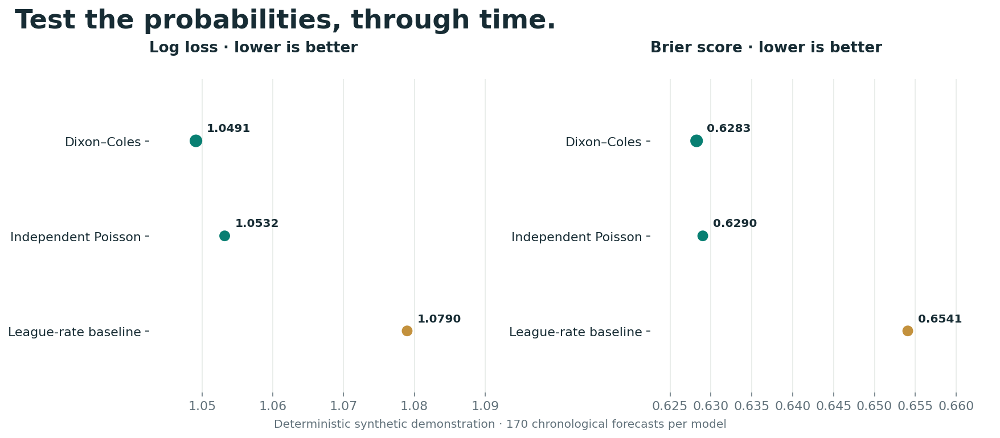
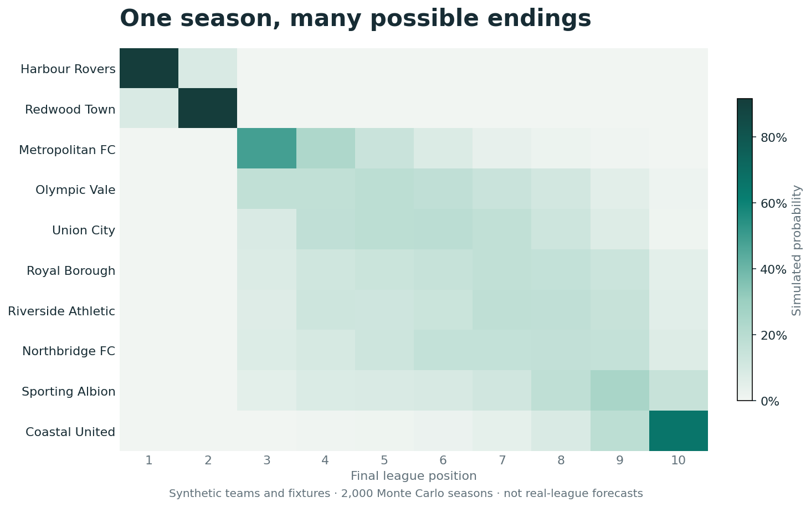

::: {.study-links}
[View repository](https://github.com/rafaelnikitas/football-forecasting-simulation){.btn .btn-outline-primary} [Open notebook](https://github.com/rafaelnikitas/football-forecasting-simulation/blob/main/football-forecasting-simulation/notebooks/01_end_to_end_forecasting_lab.ipynb){.btn .btn-outline-primary}
:::

::: {.callout-note}
The published benchmark below uses deterministic synthetic data. It verifies the pipeline and evaluation design. Real Premier League and La Liga benchmark results remain pending.
:::

## A probability distribution, not just a predicted winner

I built this lab around three connected questions: what scorelines are plausible, how well do those probabilities hold up through time, and what do they imply for the rest of a season?

An exact-score distribution supports several decisions. Summing appropriate cells gives home/draw/away probabilities or the probability of a goal threshold. Sampling future fixtures then turns match probabilities into distributions over final league positions.

## Models and a credible comparison

The lab compares a league-rate baseline, independent Poisson score models and a Dixon–Coles model. Evaluation uses expanding-window backtests: each prediction must use only earlier matches.

Log loss, Brier score and ranked probability score measure the quality of the forecast distribution. Accuracy is supplementary. When historical odds are available, the real-data workflow also includes margin-normalised market probabilities as a stronger benchmark.

## What the synthetic benchmark shows

The recorded demo makes 170 chronological predictions per model. Its results are useful evidence that the software works as intended, rather than evidence of an advantage on real football matches.

| Model | Log loss | Brier score | Ranked probability score |
|---|---:|---:|---:|
| Dixon–Coles | 1.0491 | 0.6283 | 0.2274 |
| Independent Poisson | 1.0532 | 0.6290 | 0.2276 |
| League-rate baseline | 1.0790 | 0.6541 | 0.2373 |

The small differences between the two score models should be treated cautiously. A useful real-data comparison needs more seasons, proper uncertainty estimates and consistent per-league evaluation.

## From fixtures to possible seasons

The simulation holds the observed league state fixed, samples the remaining match outcomes and records final positions. This produces a distribution, not a single asserted final table.

## Engineering choices

Provider adapters feed one canonical match schema. Statistical models, backtesting, simulation and the Streamlit interface have separate responsibilities. The project includes tests, a model card, Docker and command-line workflows.

Historical matches and current fixtures are distinct inputs. This helps prevent a later match result or an updated table from silently entering an earlier forecast.

## What remains to establish

The next substantive milestone is a multi-season EPL and La Liga benchmark against both statistical and market baselines. Injuries, lineups, promoted-team uncertainty and match-state events are outside the current model.

The [model card](https://github.com/rafaelnikitas/football-forecasting-simulation/blob/main/football-forecasting-simulation/MODEL_CARD.md) records intended use and limitations. The [README](https://github.com/rafaelnikitas/football-forecasting-simulation) explains the synthetic demo, data adapters and how to run a real-data evaluation.
